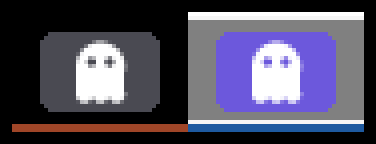

# GhostWin

hey guys i spun up this utility really quickly. it is not the same utility as the other one. there's a little purple icon on titlebars that you can click to make the window behave like it's behind everything but shining through. the ctrl+alt+g shortcut works too and there's a notification area icon you can right click on too. if it's not running as admin then some windows with higher privilege won't have the feature.

GhostWin turns any window into a **ghost**. A ghost window:

- is **see-through**: you can see what's behind it;
- floats **above every other window**, including other always-on-top windows;
- lets **clicks and typing pass straight through** to whatever is underneath.

A small button on the title bar switches a window between normal and ghost.



| Button | Where it appears | Click | Other actions |
|---|---|---|---|
| **Grey ghost** | the title bar of the window you're using | makes the window a ghost (40% visible by default) | **Right-click:** pick the opacity first |
| **Purple ghost** | every ghost window, at the same spot | brings the window back to normal, in front and focused | **Mouse wheel:** more or less visible, in 5% steps. **Right-click:** opacity, *bring back all* |

The purple button is the one part of a ghost that still takes clicks. That's how you get the window back.

## Install and use

1. Copy the program somewhere permanent, for example `%LOCALAPPDATA%\GhostWin\`:
   - `GhostWin.exe` on Intel/AMD PCs;
   - `GhostWin-arm64.exe` on ARM PCs.
2. Run it. A lavender ghost appears in the notification area.
3. Click the grey ghost button on any window's title bar.

There is no installer and nothing to uninstall: exit GhostWin and delete the file.

**Tray menu** (left- or right-click the tray icon):
- *Bring back* a single ghost, or *all* of them.
- *Opacity for new see-through windows*: 10–90%.
- *Button on the active window*: next to the window's own buttons, in the middle of the title bar, or hidden (use the keyboard instead).
- *Keyboard shortcuts*: on or off.
- *Start with Windows*.
- *How to use*.
- *Exit*. Exiting brings every ghost back to normal.

**Keys:**

| Key | Action |
|---|---|
| Ctrl+Alt+G | make the active window a ghost |
| Ctrl+Alt+Shift+G | bring back the most recent ghost |

If another app already uses a key, *How to use* says so.

**Command line** (talks to the running GhostWin, or starts it):

```bat
GhostWin.exe --ghost <window> [percent]   :: on a ghost: changes its opacity
GhostWin.exe --restore <window>
GhostWin.exe --toggle <window>
GhostWin.exe --bring-back                 :: most recent ghost
GhostWin.exe --restore-all
GhostWin.exe --exit                       :: brings everything back, then quits
```

- **`<window>`** is a window handle (decimal or `0x…`) or `active`.
- **Exit codes:**

  | Code | Meaning |
  |---|---|
  | 0 | done |
  | 1 | refused, or window not found |
  | 2 | bad arguments |
  | 3 | GhostWin isn't responding |

This makes it scriptable from AutoHotkey, PowerToys, Stream Deck and similar tools.

## How it works

GhostWin is an ordinary per-user tray app. It doesn't inject code into other programs. It uses standard window functions on other apps' windows:

| What | How |
|---|---|
| See-through | `WS_EX_LAYERED` + `SetLayeredWindowAttributes(LWA_ALPHA)` |
| Clicks pass through | `WS_EX_TRANSPARENT` |
| Above everything | `HWND_TOPMOST`. GhostWin puts ghosts back on top when another always-on-top window activates, and checks every 0.5 s |
| Keyboard goes elsewhere | after making a ghost, GhostWin activates the next window below it |
| Buttons follow windows | separate small always-on-top windows that never take focus, moved by out-of-context accessibility events (`SetWinEventHook`) with a 0.5 s re-check |
| Button position | the window's caption-button area from DWM; if unavailable, the title bar from `GetTitleBarInfo` |

### Undoing it safely

**Bringing a window back** puts back only what GhostWin changed: its own two style bits, the window's previous opacity if it already had one, and its previous always-on-top state. Changes the app itself made in the meantime are kept.

**If GhostWin crashes or is killed**, ghost windows would otherwise stay see-through and unclickable. To prevent that:
- GhostWin keeps a small record in `%LOCALAPPDATA%\GhostWin\ghosts.txt`.
- On the next start, it brings back any window still left as a ghost. It checks the window handle *and* the process ID first, so a reused handle is never touched.
- An unexpected crash also brings windows back before GhostWin exits.

**At sign-out or shutdown**, everything is brought back.

**Settings** are stored in `HKCU\Software\GhostWin`.

## Limits

- **Windows of apps running as administrator** can't be changed by a normal program (Windows blocks it). For those windows the button doesn't appear, and Ctrl+Alt+G explains why. Run GhostWin as administrator if you need them.
- **Apps that draw their own transparency** (per-pixel alpha) can't be made partly transparent without breaking how they draw. For these, GhostWin applies only click-through and always-on-top, and tells you so.
- **Custom title bars** (Chrome, Edge, VS Code, Windows Terminal and many others) don't always report where their buttons are. The grey button may then cover a tab or an icon. Switch *Button on the active window* to *Middle of the title bar*, or hide it and use Ctrl+Alt+G.
- **Store/UWP apps** may ignore the opacity change. Click-through and always-on-top still apply.
- **The button appears only on the window you're using**, not on every window at once. A ghost keeps its purple button until you bring it back.
- **Alt+Tab can still focus a ghost.** If you choose a ghost in Alt+Tab, it receives the keyboard, which can be handy for typing into a see-through window.
- **Ctrl+Alt+G is AltGr+G** on some keyboard layouts. If you type a character with AltGr+G, turn off *Keyboard shortcuts* in the tray menu.

## Testing

`tests/gw_test.cpp` drives a real `GhostWin.exe` from a separate process, the way a user would. It checks 41 things:

- the button's position on the active window, and that it can't take focus;
- clicking it: transparency, opacity, click-through, on-top, and that the keyboard moves away;
- the ghost's own button: that it's clickable and above the ghost;
- opacity changes with the mouse wheel;
- staying above another always-on-top window;
- bringing a window back;
- every command-line command and its exit codes;
- refusing tool windows;
- restoring windows that were already layered or already always-on-top;
- *bring back latest*;
- the button disappearing when a ghost window closes;
- **crash recovery** after GhostWin is killed;
- *Exit* bringing everything back.

Result: 41/41 under Wine (x64).

**It hasn't run on real Windows yet.** Wine has no desktop compositor, so it can't show the see-through effect itself (the screenshot shows ghosts opaque), and it doesn't use DWM's title-bar metrics.

To build from Linux/WSL/MSYS2 with mingw-w64 (plus ARM64 if `zig` is installed via pip):

```bash
./build.sh
```

**The icon** (`res/ghostwin.ico`, 16–256 px) is the same drawing as the tray icon and the title-bar buttons. `src/glyph.h` holds that drawing, and each size is rendered natively rather than scaled. To regenerate it after changing the drawing:

```bash
x86_64-w64-mingw32-g++ -std=c++17 -municode tools/make_icon.cpp -o make_icon.exe -static -lgdi32
wine make_icon.exe 'Z:\tmp\icon' && python3 tools/make_icon.py /tmp/icon res/ghostwin.ico screenshots/icon-sizes.png
```

To run the test on Windows:

```bat
tests\bin\gw_test.exe GhostWin.exe
```

Run it on a test account. It resets `HKCU\Software\GhostWin`.
